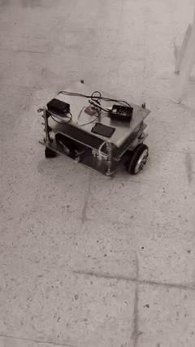
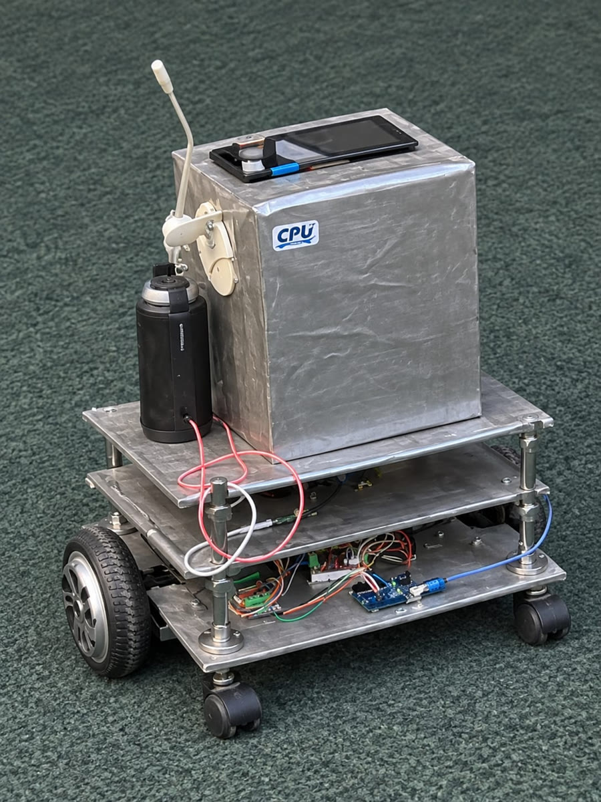
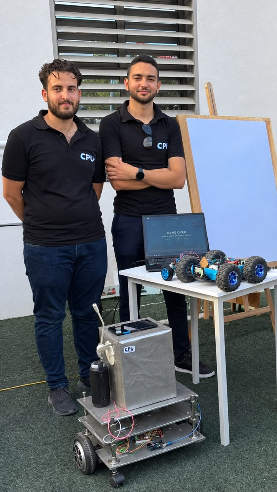
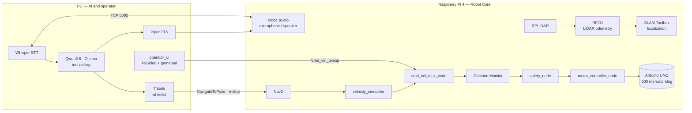

<h1 align="center">ISIMM Robot — Autonomous reception robot with a local voice assistant</h1>

<p align="center">
  
  
  
  
  
  
</p>

> Differential-drive mobile robot (Raspberry Pi 4 + hoverboard motors + LiDAR) that welcomes
> visitors to **ISIMM** (Monastir), talks out loud — **speech recognition, LLM and speech synthesis all 100% local** —
> and guides them to their destination with **Nav2**.
> Designed with safety as the top priority: the AI *requests*, the robot *decides* how to execute safely.

**English summary** — Differential-drive reception robot running ROS 2 Jazzy (Nav2, SLAM Toolbox, LiDAR odometry
without wheel encoders). A fully local voice assistant (Whisper → Qwen tool-calling → Piper) can send navigation
goals through a strict tool whitelist and can never publish velocity commands. A multi-layer safety chain
(Collision Monitor → safety node → Arduino watchdog) and a PySide6 operator console (live LiDAR, gamepad
teleoperation, e-stop) complete the system.

---

##  The robot in real

<table align="center">
  <tr>
    <td align="center" width="33%">
      <a href="docs/media/first-movement.mp4">
        
      </a><br>
      <sub><b>First movements</b> of the chassis<br><a href="docs/media/first-movement.mp4"></a></sub>
    </td>
    <td align="center" width="33%">
      <br>
      <sub><b>The robot</b>: 3-level chassis</sub>
    </td>
    <td align="center" width="33%">
      <br>
      <sub><b>The robot at the Club CPU booth</b></sub>
    </td>
  </tr>
</table>

---

##  Highlights

| | |
|---|---|
|  **100% local voice assistant** | Whisper (STT) → Qwen2.5 via Ollama (tool calling) → Piper (TTS), no cloud |
|  **Defense in depth** | Collision Monitor → `safety_node` (hard-stop) → 500 ms Arduino watchdog → hardware emergency stop |
|  **Navigation without encoders** | LiDAR odometry (RF2O) + SLAM Toolbox (localization) + Nav2 |
|  **Strict AI / robot boundary** | 7 whitelisted tools, stop without the LLM, *dry-run* mode by default, the AI never publishes `/cmd_vel` |
|  **Operator console** | PySide6: robot status, real-time LiDAR, gamepad driving with dead-man switch, e-stop |

##  Architecture



Details: [docs/architecture.md](docs/architecture.md).

##  Safety

```
Nav2 ─► velocity_smoother ─► cmd_vel_mux_node ─► Collision Monitor ─► safety_node ─► motor_controller ─► Arduino ─► motors
         (0.30 m/s max)       AUTO/MANUAL/ESTOP    stop / slowdown        LiDAR hard-stop     bounded PWM        500 ms watchdog
                              (+ /cmd_vel_teleop)                          latched e-stop                         + e-stop button
```

No direct path to the motors. Full table of protections and failure modes:
[docs/safety.md](docs/safety.md). The AI / robot boundary: [docs/AI_ROBOT_BOUNDARY.md](docs/AI_ROBOT_BOUNDARY.md).

##  Project status

- [x] Robot base: motors, LiDAR, IMU, RF2O odometry, multi-level safety
- [x] Mapping (SLAM Toolbox) and localization
- [x] Nav2 navigation with AUTO / MANUAL / ESTOP multiplexer
- [x] Local voice assistant with whitelisted tools
- [x] Operator console and gamepad driving
- [ ] Calibrated destinations in `ai/knowledge/locations.yaml` (`python -m scripts.record_location <name>`)
- [ ] ISIMM knowledge base completed (`ai/knowledge/isimm_knowledge.yaml`)
- [ ] IMU fusion (EKF) in the odometry

##  Quick start

```bash
# 1) Clone
git clone https://github.com/zaagrami-byte/cpuisimm-assistant.git ~/isimm && cd ~/isimm

# 2) PC — test the AI WITHOUT robot or ROS (text mode + simulation)
cd ai && python3 -m venv venv && source venv/bin/activate
pip install -r requirements.txt && cp .env.example .env
ollama pull qwen2.5:3b
python main.py --text --no-ros

# 3) Pi — build and launch the robot
cd ~/isimm/ros2_ws && source /opt/ros/jazzy/setup.bash
colcon build --symlink-install && source install/setup.bash
ros2 launch isimm_robot navigation.launch.py map_file:=$HOME/isimm/maps/isimm_main

# 4) PC — operator console
source /opt/ros/jazzy/setup.bash && python -m operator_ui
```

Full guides: [Pi](docs/setup-pi.md) · [PC](docs/setup-pc.md) · [Calibration](docs/calibration.md) ·
[Troubleshooting](docs/troubleshooting.md).

##  Hardware

| Component | Role |
|---|---|
| Raspberry Pi 4 | ROS 2 Jazzy, Nav2, SLAM, audio client |
| PC (CPU) | Whisper, Ollama (Qwen), Piper, operator console |
| RPLIDAR | 2D scan (SLAM, RF2O odometry, safety) |
| Arduino UNO | PWM / DIR / brake for the 2 motors, watchdog, e-stop |
| ESP32 + MPU6050 | IMU (20 Hz), ultrasonic sensors planned |
| 2 hoverboard motors | Differential drive (0.48 m track width, Ø 16.5 cm wheels) |
| Chassis | 0.57 × 0.40 × 0.30 m |

Details and wiring: [docs/hardware.md](docs/hardware.md).

## Repository structure

```
ai/             AI assistant (PC): STT, LLM, TTS, tools, ROS 2 bridge          → ai/README.md
operator_ui/    PySide6 operator console (monitoring, LiDAR, driving)
robot_audio/    Robot audio client (Pi), stdlib only
ros2_ws/        ROS 2 workspace: isimm_robot + rf2o_laser_odometry              → ros2_ws/README.md
arduino/        Motor firmware (UNO)
esp32/          IMU firmware
deploy/         systemd services (Pi, PC)
scripts/        Diagnostics (check_robot.sh)
docs/           Detailed documentation and architecture decisions (ADR)
```

##  Tests

```bash
cd ai && python -m unittest discover -s tests -t . -v                      # AI (no ROS)
QT_QPA_PLATFORM=offscreen python -m pytest operator_ui/tests -q            # operator console
cd ros2_ws/src/isimm_robot && PYTHONPATH=. python -m pytest test/test_cmd_vel_arbiter.py -q
scripts/check_robot.sh navigation                                           # running robot (read-only)
```

See [docs/testing.md](docs/testing.md).

##  Roadmap

- IMU/odometry fusion (robot_localization) and optional encoders
- Rear ultrasonic sensors (`/range/*` topics already published by the ESP32 node)
- Wake word enabled by default and multilingual dialogue (FR / AR / EN)
- Web monitoring dashboard

##  Contributing

Golden rule: no code under `ai/` ever publishes `/cmd_vel`.

##  Author and team

Designed and built by **Rami ZAAG**, training and robotics projects lead of
**Club CPU ISIMM**, at the **Institut Supérieur d'Informatique et de Mathématiques de Monastir (ISIMM)**.

Based on [RF2O](http://mapir.isa.uma.es/work/rf2o) (MAPIR, GPL v3),
[Nav2](https://nav2.org), [SLAM Toolbox](https://github.com/SteveMacenski/slam_toolbox),
[faster-whisper](https://github.com/SYSTRAN/faster-whisper), [Piper](https://github.com/rhasspy/piper) and
[Ollama](https://ollama.com).

##  Acknowledgments

I sincerely thank **all the members of Club CPU-ISIMM** and **the whole team** for their support, encouragement and invaluable help throughout this project.

Special thanks to **the entire ISIMM administration** for its trust and the support it gave to this initiative.

Thanks also to **Mr. Ahmed Attigue** and **Mr. Karim Sayeb, Secretary General**, for their support and encouragement.

— Rami ZAAG

##  License

Code distributed under the [PolyForm Noncommercial License 1.0.0](LICENSE):

-  personal, educational and non-commercial research use;
-  modifications and forks, with no obligation to publish;
-  commercial use without prior written permission (see [NOTICE.md](NOTICE.md)).

Copyright © 2026 Rami ZAAG, Club CPU ISIMM. The `rf2o_laser_odometry` package remains under GPL v3.
# isimm-robot-assitant
