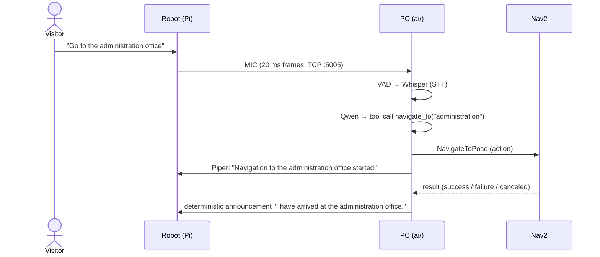

# AI Assistant



> The assistant converses in French by default (`language: fr`). The examples above are translated for readability.

## Pipeline

| Stage | Technology | Settings (`ai/config/assistant.yaml`) |
|---|---|---|
| Capture | `robot_audio` (arecord) → TCP | 16 kHz mono, 20 ms frames |
| Segmentation | `webrtcvad` | mode 3, end of utterance after 1 s of silence |
| STT | faster-whisper (CPU, int8) | `small` model, hallucination filter |
| LLM | Ollama · `qwen2.5:3b` | temperature 0.2, context 4096, 6 turns of history |
| TTS | Piper `fr_FR-siwis-medium` | sentence-by-sentence synthesis (the robot starts speaking before generation ends) |
| Wake word | transcription-based (optional) | `wake.enabled`, configurable phrases |

## Tools (allowlist)

| Tool | Effect |
|---|---|
| `get_robot_status` | Health, safety state, diagnostic observations |
| `get_robot_pose` | Position on the map (+ nearby place) |
| `get_locations` | Known and available destinations |
| `navigate_to` | Sends a Nav2 goal (automatically cancels the previous one) |
| `cancel_navigation` | Cancels the navigation |
| `get_navigation_status` | Real state: IDLE, NAVIGATING, SUCCEEDED, CANCELED, FAILED, UNKNOWN |
| `stop_robot` | Cancels navigation and triggers the emergency stop (never simulated by dry-run) |

The registry (`ai/assistant/tool_registry.py`):
- rejects any tool outside the list (`tool_not_allowed`) and logs the attempt;
- validates arguments (types, unknown parameters, length);
- converts robot errors (unreachable, Nav2 missing) into spoken messages.

## Safeguards

1. **Fast path**: "stop", "arrête" and "annule la navigation" (French phrases) are handled by regular expressions **before** the LLM.
2. **Dry-run**: `AI_DRY_RUN=true` by default; use `--live` (or `AI_DRY_RUN=false`) to send real goals.
3. **Exact destinations**: resolution after normalization (accents, articles, aliases), never fuzzy matching; a destination without coordinates is refused.
4. **Honesty**: the prompt forbids announcing arrival without confirmation; arrival announcements come from Nav2 events.
5. **Calibration**: the AI explains that it is an engineering operation and changes nothing.
6. **Degradation**: if the LLM goes down, the robot answers "small technical problem"; the voice loop never dies.

## Destinations

`ai/knowledge/locations.yaml`: coordinates in the `map` frame, `null` until recorded.

```bash
# robot placed at the desired spot, localization active
python -m scripts.record_location administration   # prints the YAML block to paste
```

## Knowledge base

`ai/knowledge/isimm_knowledge.yaml` is injected into the prompt (3000 characters max). Put **only verified facts** in it: the assistant will repeat them as-is.

## Hardware-free tests

`FakeRobot` and `FakeLLM` (`ai/tests/fakes.py`) make it possible to test the tool loop, priority stop, bounded history and announcements. See [testing.md](testing.md).
