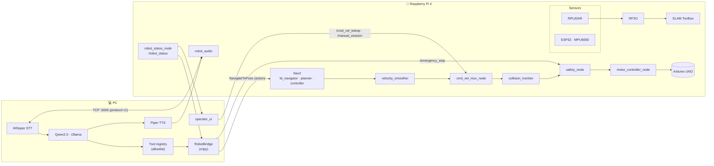

# Architecture

The system separates two worlds:

```
AI          = understanding + conversation + high-level tools   (PC)
ROBOT CORE  = physical control + safety + ROS 2 + Nav2          (Raspberry Pi)

AI → requests        ROBOT CORE → decides how to execute safely
```

## Overview



## Velocity command chain

| Step | Node | Output topic |
|---|---|---|
| 1 | `controller_server`, `behavior_server` | `/cmd_vel_nav` |
| 2 | `velocity_smoother` | `/cmd_vel_smoothed` |
| 3 | `cmd_vel_mux_node` (+ `/cmd_vel_teleop`) | `/cmd_vel_mux` |
| 4 | `collision_monitor` | `/cmd_vel` |
| 5 | `safety_node` | `/safe_cmd_vel` |
| 6 | `motor_controller_node` | serial frame `M,lpwm,ldir,lbrk,rpwm,rdir,rbrk` |

The multiplexer **never** publishes `/cmd_vel`: its output always goes through the Collision Monitor and then the `safety_node`.

## TF tree

```
map ──(SLAM Toolbox)──► odom ──(RF2O)──► base_link ──► laser_link
                                              ├──► imu_link
                                              ├──► left_wheel_link / right_wheel_link
```

`base_link` is the root of the model (no `base_footprint`): `odom → base_link` is published by RF2O.
Without encoders, the command is open loop; Nav2 closes the loop through localization.

## Robot nodes

| Node | Role |
|---|---|
| `rplidar_node` | 2D scan on `/scan` |
| `CLaserOdometry2DNode` | LiDAR odometry `/odom` + TF `odom → base_link` |
| `esp32_sensor_node` | `/imu` (20 Hz), `/range/*` (ultrasonic sensors planned) |
| `cmd_vel_mux_node` | AUTO / AUTO_WAIT / MANUAL / ESTOP arbitration (`cmd_vel_arbiter.py`, pure module, testable) |
| `safety_node` | Watchdog, validation, hard-stop, latched e-stop |
| `motor_controller_node` | Speed → PWM, 20 Hz heartbeat, reads Arduino replies |
| `robot_status_node` | 1 Hz diagnostics on `/robot_status` (per component + `overall`) |

## Launch modes

| Command | Contents | Use |
|---|---|---|
| `robot.launch.py` | Robot base | Diagnostics |
| `mapping.launch.py` | Base + `async_slam_toolbox_node` | Mapping |
| `navigation.launch.py` | Base + localization + Nav2 + mux | Production |

⚠️ Never launch *mapping* and *navigation* together: `robot.launch.py` refuses to start if the base is already running.

## Audio protocol (robot ↔ PC)

Frame: `type (1 byte) | length (4 bytes, big-endian) | payload` — v1, standard library only.

| Type | Direction | Role |
|---|---|---|
| `HELLO` / `HELLO_ACK` | Pi → PC / PC → Pi | Version and microphone format (16 kHz mono) |
| `MIC` | Pi → PC | 20 ms frames |
| `SPK_BEGIN` / `SPK_DATA` / `SPK_END` | PC → Pi | Sentence-by-sentence playback (backpressure) |
| `SPK_CANCEL` / `SPK_DONE` | PC → Pi / Pi → PC | Interruption / actual end of playback |
| `PING` / `PONG` / `BYE` | bidirectional | Heartbeat (6 s timeout) and closing |

The microphone is muted while the robot speaks (+ 400 ms tail) to avoid echo.

## Architecture decisions

See [docs/decisions/](decisions/).
