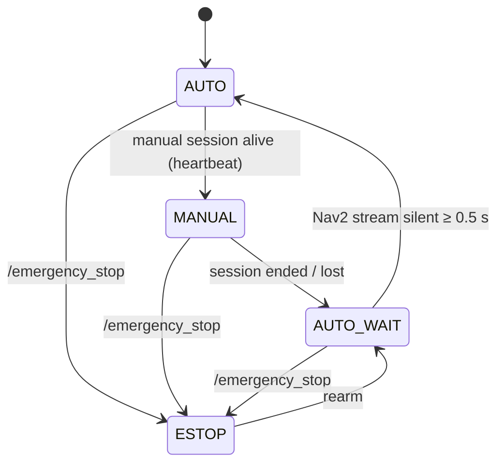

# Safety

> Principle: **no direct path to the motors**, and every layer protects even if the previous one fails.

## Protection layers

| # | Layer | Where | Protection | Values |
|---|---|---|---|---|
| 1 | Nav2 limits | `velocity_smoother`, RPP | Bounded speeds and accelerations | 0.30 m/s · 1.0 rad/s · RPP 0.20 m/s |
| 2 | Multiplexer | `cmd_vel_mux_node` | Single arbiter, NaN/Inf rejection, manual limits, ramp, no resuming of an old goal (`AUTO_WAIT`) | manual: 0.20 forward / 0.10 reverse / 0.6 rad/s |
| 3 | Collision Monitor | Nav2 | Stop if ≥ 3 points in the polygon, ×0.5 slowdown in the wide zone | stop: x∈[0.20; 0.385] · slow: up to 0.735 m |
| 4 | Safety node | `safety_node` | Latched e-stop, `/cmd_vel` (0.5 s) and `/scan` (1.0 s) timeouts, front/rear LiDAR hard-stop, clamping | front +0.06 m · rear +0.10 m · ≥ 3 points |
| 5 | Motor controller | `motor_controller_node` | PWM ≤ `max_pwm`, deadband → brake, local timeout, frames at 20 Hz even at zero, NaN ignored | `max_pwm = 100` |
| 6 | Arduino firmware | `motor_controller.ino` | 500 ms watchdog → brake, validation of every frame, serial e-stop (`S`/`C`) **and physical button** (interrupt) | `CMD_TIMEOUT_MS = 500` |
| 7 | AI boundary | `ai/` | Allowlist of 7 tools, stop without the LLM, *dry-run* by default, no `/cmd_vel` publication | see `AI_ROBOT_BOUNDARY.md` |
| 8 | Operator console | `operator_ui/` | Dead-man switch (LB), verified mapping, session heartbeat, permanent e-stop (Esc), manual only in navigation mode | 10 Hz heartbeat |

## Failure modes

| Failure | Behavior |
|---|---|
| Pi / ROS / USB cable cut | Arduino: no valid `M` frame for 500 ms → **brake** |
| Motor node stopped | Same (Arduino watchdog); `/motor_status` ≠ `OK` |
| `/scan` missing > 1 s | `safety_node`: zero command (`SCAN_TIMEOUT`) |
| `/cmd_vel` missing > 0.5 s | `safety_node`: zero command (`CMD_TIMEOUT`) |
| Obstacle ahead | Collision Monitor stops; as a last resort `HARD_STOP_FRONT` |
| Obstacle behind | `HARD_STOP_REAR` (no CM polygon at the rear) |
| NaN / Inf value | Rejected at every stage |
| Gamepad unplugged / stale (> 0.3 s) | Manual session stopped, zero command |
| Session heartbeat lost (> 0.5 s) | Mux: zero output, then `AUTO_WAIT` |
| PC ↔ robot network lost | The AI can no longer command anything; the robot stops (timeouts) |
| Spoken stop order | Deterministic fast path: `stop_robot` without going through the LLM |
| Invalid Arduino frame | Immediate braking and `ERR:*` reply |

A pure rotation is never blocked by the hard-stop (the robot can free itself).

## Emergency stop

- **Hardware**: button between pin 2 and GND (interrupt).
- **Software**: `/emergency_stop = True` → `safety_node` (latch), `motor_controller_node` (`S`), mux (`ESTOP`).
- **Rearming**: by a human only (operator console, `clear_estop` service). The AI **cannot** rearm.
- After rearming, no movement is restarted: the mux goes to `AUTO_WAIT` while Nav2 is still publishing, and manual driving must be explicitly re-enabled.

## Multiplexer state machine



## Verifying safety

```bash
scripts/check_robot.sh navigation        # read-only: publisher uniqueness, cmd_vel chain, frequencies
cd ros2_ws/src/isimm_robot && PYTHONPATH=. python -m pytest test/test_cmd_vel_arbiter.py -q
python -m pytest operator_ui/tests/test_consistency.py -q
```

> The robot must never be tested on the ground without someone within reach of the physical emergency stop button.
